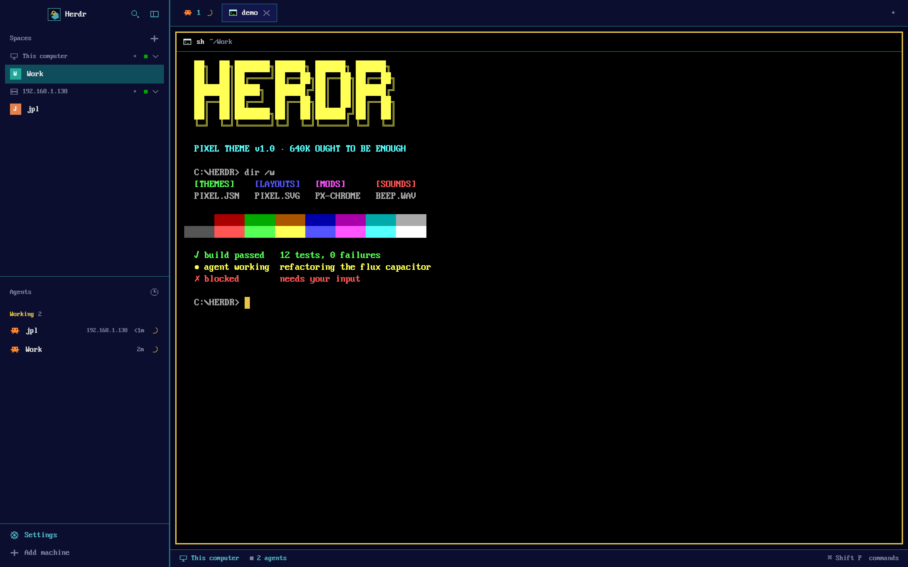

# Herdr pixel theme

A retro DOS/EGA-style theme for the [Herdr](https://herdr.dev) desktop app.



- **Colours:** dark navy panels, teal borders, gold highlights, black terminals with the 16 classic EGA colours.
- **Font:** PxPlus IBM VGA 8x16 for terminals and the interface.
- **No modern look:** square corners everywhere, 2px borders, no shadows on pop-ups opened from the window.
- **Pixel icons:** 12×12 glyphs for every sidebar, tab, pane and menu icon, plus 16×16 program icons (shell, Claude, git, node, python, vim, docker, ssh, npm, htop and more).
- **Pixel logo:** a 24×24 sprite of the Herdr ram in the theme's colours.
- **8-bit sounds:** a chiptune jingle when an agent finishes and a two-tone alarm when one is blocked.

## Install

```sh
git clone https://github.com/makefunstuff/herdr-pixel-theme
cd herdr-pixel-theme
./install.sh
```

It copies everything into `~/.config/herdr-app` (or `$HERDR_APP_HOME`) and switches Herdr to the `pixel` layout. Press `ctrl-shift-l` to cycle layouts. Run it again after pulling to update.

Notes:

- `programs.json` (the program icons) applies to every layout. The installer backs up an existing one first. Delete it to get the stock icons back.
- The sounds are set in `settings.json` and also apply to every layout.
- The `px-*` mods are copies of Herdr's own mods, so they won't pick up Herdr's later changes to those panels.
- Herdr opens a few dialogs itself (confirm, prompt, help, toasts); those keep the stock look.

## What's in it

| Path | What |
|---|---|
| `herdr-app/themes/pixel.json` | colours |
| `herdr-app/layouts/pixel.json` | the layout: fonts, square frames, which mods to use |
| `herdr-app/mods/px-*` | the window's panels and pop-ups, squared off with pixel glyphs |
| `herdr-app/pixel-icons/`, `programs.json` | program icons |
| `herdr-app/sounds/` | 8-bit alert sounds |
| `herdr-app/fonts/` | PxPlus IBM VGA 8x16 |

## Licence

Apache-2.0, as the mods are derived from Herdr's. The font is CC BY-SA 4.0. See `NOTICE`.
